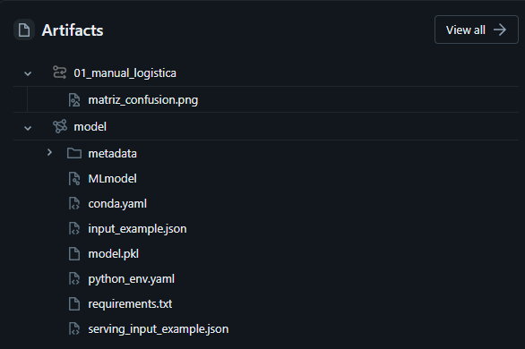

# Entrega práctica 5 — MLOps con MLflow

- **Nombre:** Emanuel Rodriguez Bedeman
- **student_id:** emanuel_rb
- **Escala:** small

Respondé cada pregunta en una a tres oraciones. Cuando se pide un dato, copiá el valor que te dieron tus notebooks.

## Mis runs

Pegá acá la tabla que imprime `03_comparar_y_elegir` (sección 5) e indicá cuál quedó registrado como `champion`.

| run | modelo | features | class_weight | umbral | hiperparametros | train_pr_auc | pr_auc | accuracy | precision | recall | f1 |
|---|---|---|---|---|---|---|---|---|---|---|---|
| exp7 | gradient_boosting | completas | ninguno | 0.5 | learning_rate=0.1, max_depth=3 | 0.608 | 0.585 | 0.918 | 0.717 | 0.353 | 0.473 |
| max_depth=8 | random_forest | completas | balanced | 0.3 | n_estimators=200, max_depth=8 | 0.632 | 0.553 | 0.641 | 0.214 | 0.924 | 0.348 |
| exp6 | logistic_regression | completas | ninguno | 0.5 | C=1.0 | 0.531 | 0.545 | 0.917 | 0.758 | 0.288 | 0.417 |
| max_depth=5 | random_forest | completas | balanced | 0.3 | n_estimators=200, max_depth=5 | 0.556 | 0.537 | 0.527 | 0.174 | 0.951 | 0.294 |
| max_depth=sin_limite | random_forest | completas | balanced | 0.3 | n_estimators=200, max_depth=sin_limite | 1.0 | 0.535 | 0.903 | 0.534 | 0.53 | 0.532 |
| max_depth=3 | random_forest | completas | balanced | 0.3 | n_estimators=200, max_depth=3 | 0.527 | 0.516 | 0.362 | 0.138 | 0.976 | 0.241 |
| exp5 | random_forest | completas | balanced | 0.3 | n_estimators=200, max_depth=3 | 0.527 | 0.516 | 0.362 | 0.138 | 0.976 | 0.241 |
| exp4 | random_forest | completas | balanced | 0.5 | n_estimators=200, max_depth=3 | 0.527 | 0.516 | 0.753 | 0.274 | 0.838 | 0.413 |
| exp3 | random_forest | completas | ninguno | 0.5 | n_estimators=200, max_depth=3 | 0.522 | 0.512 | 0.896 | 0.0 | 0.0 | 0.0 |
| 01_repro_b | random_forest | cliente | ninguno | 0.5 | n_estimators=100, max_depth=8 | 0.594 | 0.51 | 0.909 | 0.722 | 0.207 | 0.321 |
| 01_repro_a | random_forest | cliente | ninguno | 0.5 | n_estimators=100, max_depth=8 | 0.594 | 0.51 | 0.909 | 0.722 | 0.207 | 0.321 |
| exp2 | logistic_regression | cliente | ninguno | 0.5 | C=1.0 | 0.447 | 0.448 | 0.902 | 0.614 | 0.157 | 0.25 |
| 01_manual_logistica | logistic_regression | basicas | ninguno | 0.5 | C=1.0 | 0.341 | 0.339 | 0.896 | 0.493 | 0.045 | 0.082 |
| exp1 | logistic_regression | solo_regla | ninguno | 0.5 | C=1.0 | 0.179 | 0.17 | 0.896 | 0.0 | 0.0 | 0.0 |

**Run registrado:**

## Datos y tracking

**1.** ¿Cuántas filas tiene cada split de `ml_features` y qué porcentaje de contracargos hay en cada uno? ¿Por qué se separa por fecha y no al azar?

Cada split tiene:

- **train**: `35654` filas con `%11.05` de contracargos.
- **test**: `7129` filas con `%10.38` de contracargos.
- **nuevas**: `7165` filas con `%11.05` de contracargos.

Se separa por fecha para entrenar con datos anteriores (históricos) y luego evaluarlo con datos nuevos (generados en la historia), simulando como será usado en la vida real.

**2.** ¿Qué accuracy obtiene un "modelo" que siempre dice que no hay contracargo? ¿Por qué la práctica usa el PR-AUC como métrica principal?

El accuracy de un modelo que siempre dice que no hay contracargo es `89.6%`.

Se usa el **PR-AUC** porque, con clases desbalanceadas, la accuracy engaña. El PR-AUC mide qué tan bien el modelo ordena las transacciones de más a menos riesgosas, sin depender de un umbral. Un modelo al azar tiene un PR-AUC igual a la tasa de contracargos.

**3.** ¿Qué quedó registrado en el run `01_manual_logistica` como parámetros, métricas y artefactos? ¿Qué diferencia hay entre un experimento y un run?

Como parámetros quedó registrado:

| Parámetro | Valor |
|---|---|
| C | 1.0 |
| class_weight | ninguno |
| data_table | ml_features |
| data_version | 1 |
| feature_set | basicas |
| model_type | logistic_regression |
| threshold | 0.5 |

Como métricas quedó registrado:

| Métrica | Valor |
|---|---|
| test_accuracy | 0.896 |
| test_alertas | 67 |
| test_f1 | 0.082 |
| test_pr_auc | 0.339 |
| test_precision | 0.493 |
| test_recall | 0.045 |
| test_roc_auc | 0.794 |
| train_pr_auc | 0.341 |

Como Artefactos quedó registrado:

Un run es un entrenamiento: guarda sus parámetros, métricas y artefactos. Un experimento agrupa varios runs para poder compararlos. `01_manual_logistica` es un run dentro del experimento de esta clase.

**4.** ¿Cuántos parámetros registró autolog y qué métricas? ¿Qué no registra autolog que sí registramos a mano?

Autolog registró `46` parámetros del Pipeline y solo métricas de entrenamiento: **accuracy** `0.910`, **F1** `0.887`, **precision** `0.901`, **recall** `0.910`, **ROC-AUC** `0.899`, **log loss** `0.229` y **score** `0.910`.

No registró lo que cargamos a mano: las métricas de test (incluido el **PR-AUC**), el `train_pr_auc`, el umbral, el conjunto de variables y la matriz de confusión evaluada sobre test. 

**5.** ¿Dieron las mismas métricas `01_repro_a` y `01_repro_b`? Nombrá las cuatro cosas que hay que fijar para que un run sea reproducible.

Sí, dieron las mismas métricas.

Para que un experimento sea reproducible es necesario utilizar los **mismos datos**, el **mismo código**, la **misma semilla** y el **mismo entorno**.

**6.** ¿Qué pasó al llamar al modelo sin la columna `amount`? ¿Para qué sirve la firma (*signature*) del modelo?

Al llamar a un modelo sin la columna `amount` da Error. Esto sucede porque junto al modelo se guarda el *signature* del mismo, el contrato donde indica qué entradas espera el modelo y qué salida devuelve (nombres de columnas con sus tipos y el tipo de la predicción). Al eliminar la columna `amount` para generar una nueva predicción con ese modelo, esta no se encuentra dentro de su *signature* y devuelve error.

## Tus experimentos

**7.** ¿Cuál fue tu mejor run (modelo, variables, hiperparámetros y PR-AUC)? ¿Cuánto mejoró respecto de usar sólo `rule_alert` (`solo_regla`)?

El mejor run fue `max_depth=8`: *random forest*, variables `completas`, `class_weight = balanced`, `200` árboles, `max_depth = 8` y umbral `0.3`. El **PR-AUC** de test fue `0,553`.

`solo_regla` (`exp1`) tuvo `0,170`. El *random forest* mejora esa base en `0,383`.

**8.** Con el mismo modelo, ¿cuánto cambió el PR-AUC al pasar de `basicas` a `cliente` y a `completas`? ¿Qué variables resultaron más importantes en tu mejor run?

Con la misma regresión logística (`C = 1`, sin `class_weight`, umbral 0,5) el PR-AUC pasó de `0,339` con `basicas` a `0,448` con `cliente` (`+0,109`) y a `0,545` con `completas` (`+0,097`). Agregar el perfil del cliente y después el contexto de la compra mejora el orden de riesgo.

Las variables más importantes de mi mejor run fueron:

- amount
- payment_channel
- amount_to_price
- category
- account_age_days
- hour
- is_night
- device_customers
- segment
- day_of_week
- country
- price

**9.** Con `completas`, ¿qué modelo anduvo mejor: logística, bosque o boosting? ¿Por qué un modelo de árboles puede aprovechar combinaciones de variables (por ejemplo, de noche *y* por transferencia) que una logística no ve?

Con `completas`, el *gradient boosting* (`exp7`, **PR-AUC** `0,585`) quedó arriba del *random forest* (`max_depth=8`, `0,553`) y de la *regresión logística* (`exp6`, `0,545`).

Un árbol puede partir primero por la noche y, solo en esa rama, por el canal. Así usa la combinación "de noche y por transferencia". La logística suma cada variable por separado y no ve esa combinación si no se la agrega como columna.

**10.** ¿Qué cambió en precision, recall y cantidad de alertas al usar `class_weight = balanced`? ¿Cambió mucho el PR-AUC?

Entre `exp3` (`class_weight = ninguno`) y `exp4` (`balanced`), con el mismo random forest, variables y umbral, la precision pasó de `0` a `0,274` y el recall de `0` a `0,838`. Sin balanceo no hubo alertas. Con balanceo el modelo pasa a detectar la mayoría de los contracargos, a costa de muchas alertas falsas.

El **PR-AUC** casi no cambió: `0,512` a `0,516`. El balanceo mueve quién se alerta, no el orden de riesgo.

**11.** ¿Qué pasó al bajar el umbral? ¿Por qué el PR-AUC no depende del umbral y el F1 sí?

Al bajar el umbral de 0,5 (`exp4`) a 0,3 (`exp5`), con el mismo random forest, el recall pasó de `0,838` a `0,976` y la precision de `0,274` a `0,138`. Se detectan más contracargos y aparecen más alertas falsas. El **F1** baja de `0,413` a `0,241`.

El PR-AUC quedó en `0,516`. No depende del umbral porque resume el ranking en todos los cortes. El **F1** se calcula en el corte elegido, así que cambia cuando se mueve el umbral.

**12.** ¿Qué hiperparámetro barriste y con qué valor obtuviste el mejor PR-AUC de test? ¿Hubo valores con `train_pr_auc` mucho más alto que el de test? ¿Cómo se llama ese fenómeno?

Barrí `max_depth` en un random forest con variables completas, `class_weight = balanced`, `umbral = 0,3` y `200` árboles. El mejor **PR-AUC** de test fue `0,553`, con `max_depth = 8`. Con sin_limite el `train_pr_auc` llegó a `1,0` y el de test quedó en `0,535`. Ese desfase se llama **sobreajuste**: el modelo memoriza el entrenamiento.

## Comparar y elegir

**13.** ¿Coincidieron tu mejor run por PR-AUC y tu mejor run por accuracy? Explicá por qué pueden no coincidir.

Sí, coincidieron. El mejor run por **PR-AUC** y por **accuracy** fue **exp7**: gradient boosting, variables completas, sin `class_weight`, `umbral 0.5`, `learning_rate = 0,1` y `max_depth = 3`. El **PR-AUC** de test fue `0,585` y la **accuracy** `0,918`.

Pueden no coincidir porque la **accuracy** premia acertar la clase mayoritaria y el **PR-AUC** premia ordenar los contracargos. Con pocos contracargos, un modelo que casi no alerta puede tener **accuracy** alta y **PR-AUC** bajo.

**14.** En el gráfico de **PR-AUC** de train contra test, ¿qué runs quedan más lejos de la diagonal y qué indica eso?

El run más lejos de la diagonal es `max_depth=sin_limite`: **PR-AUC** de train `1,0` y de test `0,535`. Indica sobreajuste. El modelo memoriza el entrenamiento y en datos nuevos el orden de riesgo empeora. El resto de los runs queda cerca de la diagonal.

**15.** ¿Qué ventaja tiene consultar los runs con `mlflow.search_runs` en lugar de mirarlos en la interfaz? Escribí el `filter_string` que usarías para traer sólo tus bosques con **PR-AUC** de test mayor a `0,55`.

`search_runs` deja los runs como una tabla: se filtra y se ordena sin marcarlos uno por uno en la interfaz. Para traer sólo mis bosques con **PR-AUC** de test mayor a `0,55`:

`tags.student_id = 'emanuel_rb' AND params.model_type = 'random_forest' AND metrics.test_pr_auc > 0.55`

En mis runs cumple `max_depth=8`, con **PR-AUC** de test `0,553`.

**16.** En fraude, ¿qué cuesta más, una alerta falsa o un contracargo no detectado? Si el equipo de riesgo sólo puede revisar una cantidad fija de alertas por día, ¿cómo usarías el umbral?

Cuesta más un contracargo no detectado: se pierde el monto. Una alerta falsa cuesta el tiempo de revisión.

Si el equipo tiene un cupo fijo, el umbral se elige para que la cantidad de alertas entre en ese cupo. El modelo ya ordena por riesgo, así que se revisan primero las de mayor score. Bajar el umbral sube el `recall` y también las alertas falsas, como de `exp4` (`umbral 0,5`, `recall 0,838`) a `exp5` (`umbral 0,3`, `recall 0,976`).

## Registro, uso y monitoreo

**17.** ¿Se pudo registrar el modelo en Unity Catalog? Indicá nombre, versión y alias (o el error, si falló). ¿Qué ventaja tiene cargar `models:/...@champion` en lugar de `runs:/<run_id>/model`?

Sí, se registró en *Unity Catalog*. Bajo el nombre `workspace.bigdata_emanuel_rb.fraud_model` ya existía, así que se creó la versión `3`, en estado `READY`, y se le asignó el alias `champion`. El run de esa versión es `5c18c9a7141f4b70b9ac551cf916b183`. Las versiones `1` y `2` siguen registradas.

La ventaja de `models:/workspace.bigdata_emanuel_rb.fraud_model@champion` es que el proceso que puntúa siempre pide "el champion" y no conoce el `run_id`. Cuando hay un modelo mejor, se mueve el alias champion a esa versión y el código sigue apuntando al deseado. Con `runs:/5c18c9a7141f4b70b9ac551cf916b183/model` la ruta nombra un entrenamiento concreto: para usar otro hay que cambiar la ruta en cada lugar que cargue el modelo.

**18.** ¿Cuántas transacciones nuevas se puntuaron y cuántas generaron alerta? ¿Qué columnas de `ml_predictions` permiten auditar cada decisión? ¿Por qué el umbral se guarda fuera del modelo?

<04_registro_y_uso, sección 3: Inferencia batch: puntuar las transacciones nuevas>

- Transacciones puntuadas: `7,165` 
- Transacciones que generaron alertas: `355` (`5.0%`)

Las columnas que permiten auditar cada decisión son: `model_name`, `model_version`, `run_id`, `threshold` y `scored_at`, además de `score` y `alerta`.

El umbral se guarda fuera del modelo porque se puede cambiar sin reentrenar: es el corte de negocio, no un parámetro aprendido.

**19.** Cuando llegaron los contracargos, ¿el PR-AUC sobre `nuevas` fue parecido al de test? En la campaña simulada, ¿qué pasó con el porcentaje de alertas? ¿Qué es el drift y por qué se puede detectar antes de tener las etiquetas?

<04_registro_y_uso, sección 5: ¿Y si cambian los datos?>

Sí, el PR-AUC sobre `nuevas` fue parecido al de `test`:

| métrica | test | nuevas |
| --- | --- | --- |
| pr_auc | 0.585 | 0.576 |

Esto sucede porque afortunadamente, los datos de "nuevas" son muy similares a los de entrenamiento.

En la campaña simulada, donde los datos no son parecidos al de entrenamiento (las compras son más caras y hay más pagos por transfer), el porcentaje de alertas nuevas pasa de `5.0%` a un `12.6%`.

El drift es el cambio de distribución de una variable predictora (*data drift*) ó de la variable objetivo (*model drift*). En el caso de la campaña simulada sucede el primer tipo de **drift**.

Lo que debería hacerse en este caso es modificar el umbral ó reentrenar con estos datos más recientes, generar una nueva versión y asignarle el alias `champion`.

## Cierre

**20.** Ubicá lo que hiciste en el ciclo de vida de MLOps (datos, entrenamiento, tracking, registro, despliegue, monitoreo). ¿Qué faltaría para tener este modelo en producción real? Nombrá al menos dos cosas.

De MLflow ya están hecho el **Tracking**, el **empaquetado** del modelo y el **Model Registry**: el experimento con parámetros y métricas, el modelo cargado para puntuar, y workspace.bigdata_emanuel_rb.fraud_model versión 3 con alias champion.

Para producción real faltan dos cosas. Un **serving** de verdad, batch programado o en tiempo real, con pruebas y un despliegue repetible antes de mover champion. Y un **monitoreo** continuo que detecte el tipo de drift (data drift ó model drift), **alerte** al equipo y dispare el reentrenamiento, en lugar de una comparación hecha una sola vez en el notebook.
