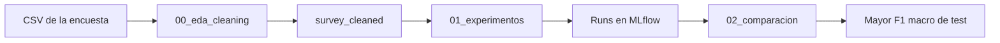

# TP final — Efecto de la música

**Estudiante:** Emanuel Rodriguez Bedeman (`emanuel_rb`)

**Variante 2:** Ejecución. **Opción B** — experimentación y comparación de modelos con MLflow.

## Objetivo

Predecir si una persona dice que la música le mejora, no le hace nada o le empeora la salud mental, a partir de sus hábitos de escucha. Es una clasificación de la variable Music effects, con las clases Improve, No effect y Worsen. La métrica de comparación es el `F1` macro de test: el promedio del `F1` de las tres clases, con el mismo peso para cada una. La accuracy queda corta porque el 74 % de las respuestas ya es Improve, y un modelo que siempre elige esa clase acierta eso sin distinguir las otras dos.

## Contenido

| Archivo | Qué es |
|---|---|
| `data/mxmh_survey_results.csv` | Encuesta, 736 respuestas y 33 columnas |
| `00_eda_cleaning.ipynb` | Exploración y limpieza de tipos. Deja la tabla `survey_cleaned` |
| `01_experimentos.ipynb` | Feature engineering, corte, modelos y registro en MLflow |
| `02_comparacion.ipynb` | Compara los runs y elige el mejor F1 macro de test |
| `README.md` | Esta guía, con las limitaciones |

## Datos

Fuente: [Music & Mental Health Survey Results](https://www.kaggle.com/datasets/catherinerasgaitis/mxmh-survey-results), Catherine Rasgaitis. Licencia CC0. El CSV está en el repo porque es público además no es necesario almacenar ningún tipo de credencial de kaggle para acceder a él en databricks.

Los datos se generaron a través de encuesta de un Google Forms publicado en Reddit, Discord y redes. No es una muestra de la población.

## Calidad de los datos

La exploración de `00_eda_cleaning.ipynb` muestra faltantes por columna, filas sin `Music effects` y valores de `BPM` que no son un tempo. El notebook marca BPM fuera de 40–250. Ese rango no viene de la encuesta: un tema suele ir de 60 a 180, y 40–250 es un margen ancho para ver valores imposibles, como 0 o 999999999.

Al guardar, `00_eda_cleaning.ipynb` tira las 8 filas sin `Music effects`. La clase no se imputa. `3-Tratar BPM` arranca en `conservar` y el BPM queda como está. Con `anular_imposibles`, un BPM fuera de 40–250 pasa a nulo y la fila sigue. Eso, y la mediana y la moda, se calculan en `01_experimentos.ipynb` con el train, después del corte.

La limpieza que sí queda hecha es de tipos y de una columna: `Permissions` se elimina. Solo registra si la persona aceptó que se publique su respuesta. No dice nada del hábito de escucha ni de `Music effects`, que es la etiqueta. Las columnas sí/no (`While working`, `Instrumentalist`, `Composer`, `Exploratory`, `Foreign languages`) quedan como texto: `Yes`, `No` o vacío. En `Primary streaming service`, `I do not use a streaming service` pasa a `No streaming` y `Other streaming service` pasa a `Other`.

## Columnas

| Columna | Qué es |
|---|---|
| `Timestamp` | Fecha y hora en que envió el formulario |
| `Age` | Edad |
| `Primary streaming service` | Servicio de música que más usa |
| `Hours per day` | Horas de música por día |
| `While working` | Si escucha música mientras trabaja |
| `Instrumentalist` | Si toca un instrumento |
| `Composer` | Si compone música |
| `Fav genre` | Género favorito |
| `Exploratory` | Si busca artistas o géneros nuevos |
| `Foreign languages` | Si escucha música en otros idiomas |
| `BPM` | Pulsos por minuto que declaró (*beats per minute*) |
| `Frequency [Classical]` | Con qué frecuencia escucha classical |
| `Frequency [Country]` | Con qué frecuencia escucha country |
| `Frequency [EDM]` | Con qué frecuencia escucha EDM |
| `Frequency [Folk]` | Con qué frecuencia escucha folk |
| `Frequency [Gospel]` | Con qué frecuencia escucha gospel |
| `Frequency [Hip hop]` | Con qué frecuencia escucha hip hop |
| `Frequency [Jazz]` | Con qué frecuencia escucha jazz |
| `Frequency [K pop]` | Con qué frecuencia escucha K-pop |
| `Frequency [Latin]` | Con qué frecuencia escucha latin |
| `Frequency [Lofi]` | Con qué frecuencia escucha lofi |
| `Frequency [Metal]` | Con qué frecuencia escucha metal |
| `Frequency [Pop]` | Con qué frecuencia escucha pop |
| `Frequency [R&B]` | Con qué frecuencia escucha R&B |
| `Frequency [Rap]` | Con qué frecuencia escucha rap |
| `Frequency [Rock]` | Con qué frecuencia escucha rock |
| `Frequency [Video game music]` | Con qué frecuencia escucha música de videojuegos |
| `Anxiety` | Puntaje autodeclarado de ansiedad, de 0 a 10 |
| `Depression` | Puntaje autodeclarado de depresión, de 0 a 10 |
| `Insomnia` | Puntaje autodeclarado de insomnio, de 0 a 10 |
| `OCD` | Puntaje autodeclarado de trastorno obsesivo-compulsivo, de 0 a 10 |
| `Music effects` | Si la música le mejora (`Improve`), no le hace nada (`No effect`) o le empeora (`Worsen`) |
| `Permissions` | Si aceptó que se publique su respuesta. Se elimina en la limpieza |

## Preparación en Spark

La carga, el casteo y la escritura de `survey_cleaned` corren con Spark. La tabla queda en `{catalogo}.bigdata_emanuel_rb.survey_cleaned`, con los nombres en minúscula y con `_` (`Music effects` pasa a `music_effects`). De las 736 filas del CSV se guardan 728: salen las 8 sin `music_effects`. El nulo de BPM imposible, si el widget lo pide, se aplica en `01_experimentos.ipynb`, en el driver, porque la mediana tiene que salir solo del train. El entrenamiento es scikit-learn. Con este tamaño, un entrenamiento distribuido no cambia el resultado.

## Features

Qué scores entran como variables se elige en `01_experimentos.ipynb`, con el widget `2-Scores`. El default es `todos`: entran `anxiety`, `depression`, `insomnia` y `ocd`. `ninguno` no entra ninguno. Cada puntaje también se puede marcar solo. El widget `4-Como entrenar` arranca en `automatico` y, con ese valor, registra los cuatro modelos de la tabla de abajo aunque se hayan tocado los de hiperparámetros. En `manual` entrena un solo modelo con esos widgets y lo guarda con otro nombre, para no reemplazar los cuatro runs de la comparación. `3-Tratar BPM` arranca en `conservar`: el `bpm` queda como está en la tabla. `anular_imposibles` pasa a nulo un valor menor a 40 o mayor a 250 y la fila se queda.

## Modelos previstos

Los cuatro ven la misma matriz y el mismo corte 80/20 estratificado (`random_state=7`). **Random forest**, **LightGBM** y **CatBoost** usan balanceo de clases. La logística no. Gana el mayor F1 macro de test.

| Run | Modelo |
|---|---|
| `exp_01` | Regresión logística, `C=1`, sin balanceo |
| `exp_02` | Random forest, 100 árboles, sin tope de profundidad, `class_weight='balanced'` |
| `exp_03` | LightGBM, 100 árboles, sin tope de profundidad, `class_weight='balanced'` |
| `exp_04` | CatBoost, 100 iteraciones, profundidad 6, `auto_class_weights='Balanced'` |

Esos valores coinciden con la columna Default de los widgets, pero en `automatico` no se leen de ahí: están fijos en el código. Cambiar `5-Modelo`, el balanceo, `C`, los árboles o la profundidad no cambia esta corrida. La profundidad `sin_limite` no se pasa al bosque ni a LightGBM, así que crecen sin tope. En CatBoost esa opción deja la profundidad 6 de la librería. `C=1` solo aplica a la logística.

`mlflow.autolog()` queda prendido. Al entrenar guarda los parámetros del pipeline, las métricas de ese ajuste y el modelo. El notebook suma el F1 macro de train y de test, el F1 de cada clase y la matriz, que son los nombres que lee `02_comparacion.ipynb`. El experimento es `/Users/<usuario>/bigdata_emanuel_rb_tp_final`. Cada entrenamiento es un run.

De cada run se guardan:

- **Parámetros:** modelo, modo (`automatico` o `manual`), tratamiento del BPM, balanceo, `C`, árboles, profundidad, scores, filas y corte.
- **Métricas:** F1 macro de train, F1 macro de test, accuracy de test y el F1 de `Improve`, `No effect` y `Worsen`.
- **Artefactos:** la figura `matriz_confusion.png` y el pipeline que guarda autolog al hacer `fit`. En MLflow 3 el pipeline aparece en **Logged models**.

Esos parámetros son la trazabilidad del run. Con `modelo`, `que_entrenar`, `tratar_bpm`, `puntajes_salud`, `balanceo`, `C`, `n_arboles`, `profundidad`, `random_state`, las filas de train y de test y el nombre de la tabla se puede reconstruir con qué matriz se entrenó. `02_comparacion.ipynb` las muestra al lado del F1. De cada nombre se queda el último run terminado. La comparación usa `exp_01` a `exp_04`.

La tabla de abajo no es esa corrida. Es una prueba local, con la misma semilla, scikit-learn 1.9.1, LightGBM 4.7.0 y CatBoost 1.2.10, sin puntajes de salud (`puntajes_salud=ninguno`) y con el BPM imposible en nulo (`tratar_bpm=anular_imposibles`). Los nombres son el modelo, no `exp_01` a `exp_04`. El número de la entrega es el que imprime `02_comparacion.ipynb` en Databricks, con el default: `puntajes_salud` los cuatro scores y `tratar_bpm=conservar`. Si el runtime trae otra versión, el cuarto decimal se puede mover.

| Modelo de esa prueba | F1 macro test | F1 macro train | Accuracy test | F1 Improve | F1 No effect | F1 Worsen |
|---|---:|---:|---:|---:|---:|---:|
| random forest | 0.3891 | 1.0000 | 0.7192 | 0.8225 | 0.3448 | 0.0000 |
| lightgbm | 0.3775 | 1.0000 | 0.7260 | 0.8305 | 0.3019 | 0.0000 |
| catboost | 0.3713 | 1.0000 | 0.6986 | 0.8087 | 0.3051 | 0.0000 |
| logística | 0.3387 | 0.6673 | 0.6781 | 0.8017 | 0.2143 | 0.0000 |

En esa prueba local el mayor F1 macro fue el random forest. Train 582 filas, test 146 (Improve 109, No effect 34, Worsen 3). Ningún modelo acertó una fila `Worsen` del test. Los tres árboles llegan a F1 macro 1 en train y bajan a menos de 0.40 en test: memorizan este corte. La logística no memoriza tanto y queda última en la métrica de esa prueba. No es el modelo elegido de la entrega: ese sale de `exp_01` a `exp_04` con los widgets por defecto.

## Comparación, elección y limitaciones

La comparación y la elección están en `02_comparacion.ipynb`. No vuelve a entrenar: `mlflow.search_runs` lee los runs terminados, deja el más reciente de cada nombre, los ordena por F1 macro de test y muestra al lado quién ganaría por accuracy. Los gráficos comparan los runs entre sí y el F1 de train contra el de test. La sección **Por qué ese criterio** justifica la elección: gana el mayor F1 macro de test, fijado antes de mirar la tabla, porque las tres clases pesan igual y la accuracy favorece a `Improve`.

<tabla de runs de 02_comparacion.ipynb en Databricks>

<tabla del mejor F1 macro y del mejor por accuracy>

| run | modelo | que_entrenar | tratar_bpm | balanceo | puntajes_salud | train_f1_macro | test_f1_macro | test_accuracy | f1_improve | f1_no_effect | f1_worsen |
|---|---|---|---|---|---|---|---|---|---|---|---|
| exp_04 | catboost | automatico | conservar | como_la_comparacion | anxiety,depression,insomnia,ocd | 1.0 | 0.3928 | 0.726 | 0.8276 | 0.3509 | 0.0 |
| lightgbm | lightgbm | automatico | anular_imposibles | como_la_comparacion | ninguno | 1.0 | 0.3758 | 0.7397 | 0.8417 | 0.2857 | 0.0 |
| exp_01 | logistica | automatico | conservar | como_la_comparacion | anxiety,depression,insomnia,ocd | 0.5984 | 0.3611 | 0.7055 | 0.824 | 0.2593 | 0.0 |
| exp_03 | lightgbm | automatico | conservar | como_la_comparacion | anxiety,depression,insomnia,ocd | 1.0 | 0.3498 | 0.7055 | 0.8186 | 0.2308 | 0.0 |
| logistica | logistica | automatico | anular_imposibles | como_la_comparacion | ninguno | 0.5553 | 0.3442 | 0.7123 | 0.8285 | 0.2041 | 0.0 |
| catboost | catboost | automatico | anular_imposibles | como_la_comparacion | ninguno | 1.0 | 0.3287 | 0.6575 | 0.7826 | 0.2034 | 0.0 |
| random_forest | random_forest | automatico | anular_imposibles | como_la_comparacion | ninguno | 1.0 | 0.3051 | 0.7534 | 0.8583 | 0.0571 | 0.0 |
| exp_02 | random_forest | automatico | conservar | como_la_comparacion | anxiety,depression,insomnia,ocd | 1.0 | 0.2835 | 0.7397 | 0.8504 | 0.0 | 0.0 |

<gráfico de barras del F1 macro de test>

<gráfico de F1 macro de train contra test>

Las limitaciones están en la sección siguiente de este README, no en el notebook.

## Limitaciones

La encuesta salió de un Google Form en Reddit, Discord y redes. Quien respondió eligió entrar. El modelo no dice qué le pasa a alguien que no contestó este formulario.

`music_effects` y los puntajes de 0 a 10 son lo que la persona escribió, no un diagnóstico.

`Worsen` tiene 17 filas en toda la encuesta y alrededor de 3 en el test. Con tan pocas, el F1 de esa clase se mueve si cambia la semilla, y el orden entre modelos también.

Los árboles de la prueba local memorizan el train: el F1 macro de train llega a 1 y el de test queda mucho más abajo. Los hiperparámetros de la comparación fija están fijos. No hay búsqueda ni validación cruzada: un solo corte 80/20, `random_state=7`. La elección es el mejor F1 macro de test en ese corte, no un resultado sobre la población.

No hay una segunda tanda de respuestas. Si llegara, se podría mirar si cambia la mezcla de géneros (covariables), la proporción de `Improve`, `No effect` y `Worsen` (etiqueta) o la relación entre los hábitos y `music_effects` (concepto). Con un solo formulario eso no se mide.

## Cómo correr

1. En Databricks, abrir `00_eda_cleaning.ipynb` con un cluster de notebooks, no con un SQL warehouse.
2. Dejar el widget `Archivo CSV` como viene: apunta a `data/mxmh_survey_results.csv` al lado del notebook.
3. Ejecutar de arriba hacia abajo. Tiene que quedar escrita `{catalogo}.bigdata_emanuel_rb.survey_cleaned`. Si esa tabla se escribió antes, con las columnas sí/no como boolean o todavía con las 8 filas sin etiqueta, hay que correr este notebook otra vez: el `overwrite` la reemplaza.
4. Abrir `01_experimentos.ipynb` en el mismo tipo de cluster. Para la corrida por defecto, `2-Scores` queda en `todos`, `3-Tratar BPM` en `conservar` y `4-Como entrenar` en `automatico`. La tabla local de arriba se hizo sin puntajes de salud y con el BPM imposible en nulo: para repetirla, `2-Scores` se pasa a `ninguno` y `3-Tratar BPM` a `anular_imposibles`.
5. Ejecutar de arriba hacia abajo. La primera celda instala LightGBM y CatBoost si el cluster no los tiene. La siguiente reinicia Python para que tome los paquetes. Seguir desde la celda de los widgets. Los cuatro runs quedan en `/Users/<usuario>/bigdata_emanuel_rb_tp_final`. Un experimento suelto se hace pasando `4-Como entrenar` a `manual` y volviendo a ejecutar desde la celda de la partición.
6. Abrir `02_comparacion.ipynb` y ejecutarlo de arriba hacia abajo. No entrena: lista los runs terminados, muestra el mejor por F1 macro al lado del mejor por accuracy, grafica el orden y el train contra el test, y justifica la elección. Las limitaciones están en este README.
